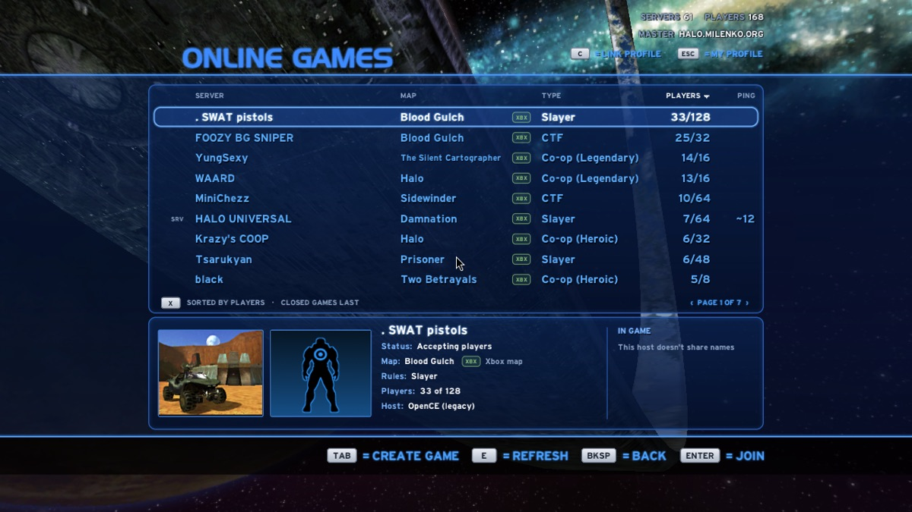
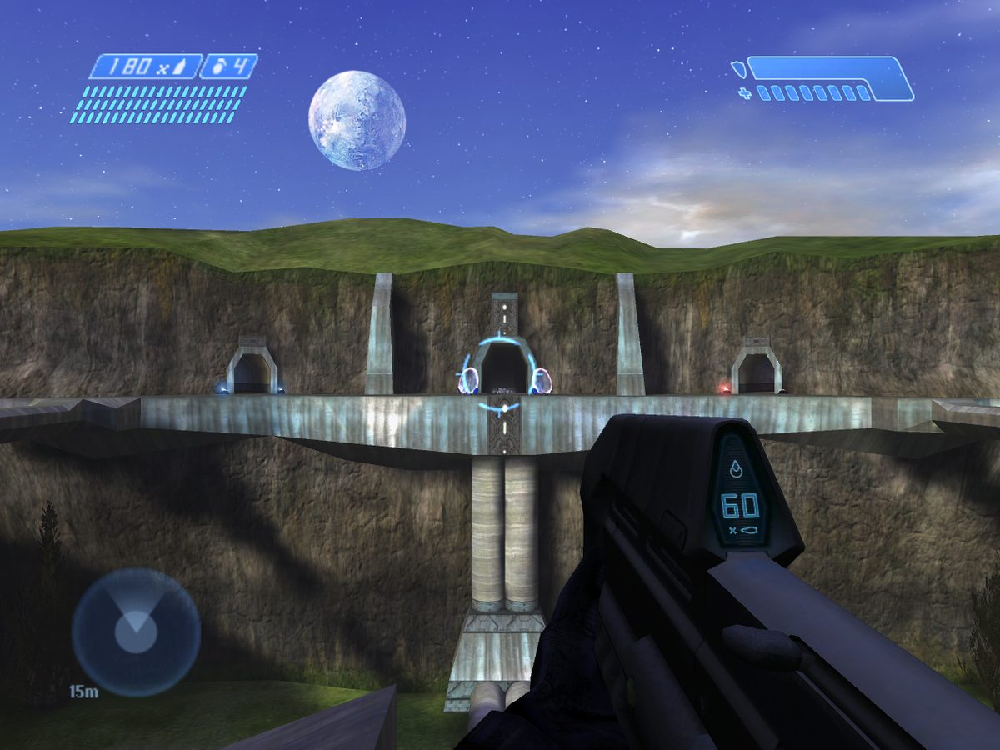

<h2 align="center">Chupathingy</h2>

<b>Halo CE: Ported for Everyone.</b>

In testing 

Community ports 

<a href="https://github.com/ChupathingyCE/chupathingyce/releases/latest">Download</a> ·
<a href="https://chupathingy.org">chupathingy.org</a> ·
<a href="https://stats.chupathingy.org">Games online now</a> ·
<a href="https://discord.gg/chupathingy">Discord</a>

### Play

1. Download Chupathingy for your computer or phone.
2. Start it and point it at your own copy of Halo: Combat Evolved.
3. Open Multiplayer, then Online Games, and pick a game.

Our servers are up around the clock, next to the ones the community runs.

### What you get

- The campaign, split screen, System Link and online play.
- Xbox maps, plus Halo PC, Custom Edition and HaloMD maps. Missing Custom Edition maps download for you.
- The Xbox menus, with the settings people kept asking for.
- Controller layouts, Bumper Jumper included, and high-res HUD and text.
- Carnage reports, medals and service records on the site.
- Dedicated servers anyone can run.

Everything extra is optional. By default, it plays like Halo.

### Projects

| | |
| --- | --- |
| [chupathingyce](https://github.com/ChupathingyCE/chupathingyce) | The game for Windows, Mac, Linux (Steam Deck too), Android and FreeBSD, plus the dedicated server. |
| [warthog-xbox](https://github.com/ChupathingyCE/warthog-xbox) | The original Xbox. Test builds. |
| [warthog-360](https://github.com/ChupathingyCE/warthog-360) | The Xbox 360. Test builds. |
| [warthog-wiiu](https://github.com/ChupathingyCE/warthog-wiiu) | The Wii U. Test builds. |
| [warthog-switch](https://github.com/ChupathingyCE/warthog-switch) | The Nintendo Switch, by thelinkin3000. Test builds. |
| Community ports | PSP, PS Vita, PS3, PS4, PS5 and Xbox Series (UWP), made by other developers. They play in the same games. |
| [stats.chupathingy.org](https://stats.chupathingy.org) | The game list, carnage reports, service records and leaderboards. |

The consoles play online with everyone else. Every build needs your own copy of the game.

### Where it came from

Chupathingy is a port of the Halo: Combat Evolved decompilation. It started as a fork of OpenCE, and it still plays with OpenCE players when the versions match.

### Get involved

Bug reports, ideas, maps, mods and pull requests are welcome. Start on the [Discord](https://discord.gg/chupathingy) or in the game's [issues](https://github.com/ChupathingyCE/chupathingyce/issues).

### Support the servers

Chupathingy is free and always will be. Support through [Ko-fi](https://ko-fi.com/milenko) pays for the site and the servers. If you want to support a specific developer or port, ask them directly. They may not be part of our community.

---

Chupathingy is an unofficial fan project. It isn't affiliated with or endorsed by Microsoft, Xbox Game Studios, Bungie or Halo Studios. Halo is a trademark of Microsoft. Platform names and logos are trademarks of their owners, used only to identify platforms (logos from Simple Icons, CC0). No game files are included: you bring your own copy.
