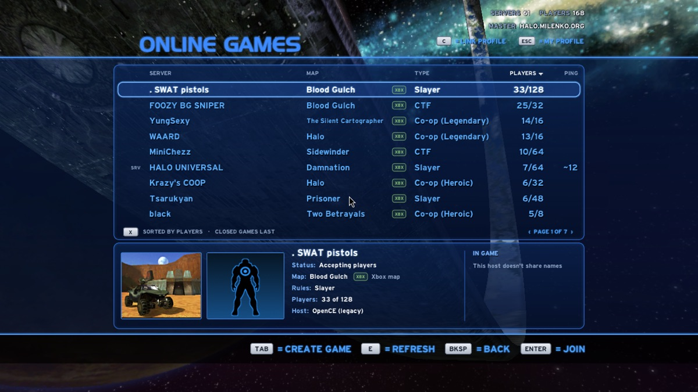
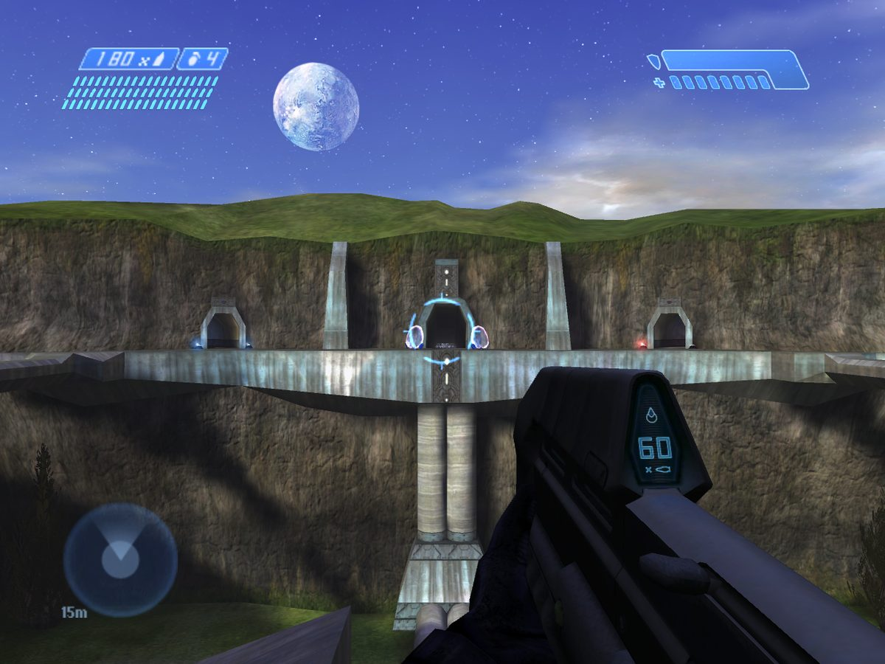

<h2 align="center">Chupathingy</h2>

<b>Halo CE: Ported for Everyone.</b>

In testing 

Community ports 

<a href="https://github.com/ChupathingyCE/chupathingyce/releases/latest">Download</a> ·
<a href="https://chupathingy.org">chupathingy.org</a> ·
<a href="https://stats.chupathingy.org">Games online now</a> ·
<a href="https://discord.gg/chupathingy">Discord</a>

Chupathingy is a port of the Halo: Combat Evolved decompilation. It plays the campaign, split screen, System Link and online games on computers, phones and consoles, all in the same games. It reads Xbox, Halo PC, Custom Edition, HaloMD and MCC Workshop maps. By default, it plays like Halo.

No game files are included. You bring your own copy of the game.

### Where to start

1. **Get it:** download the [latest release](https://github.com/ChupathingyCE/chupathingyce/releases/latest) for your computer or phone. Console builds are on each console's releases page below.
2. **Set it up:** start it and point it at your own copy of Halo: Combat Evolved.
3. **Play:** open Multiplayer, then Online Games. You can also see who's playing on [stats.chupathingy.org](https://stats.chupathingy.org).
4. **Get help:** ask on the [Discord](https://discord.gg/chupathingy). Fixes for common problems and how to send your logs are in [docs/help.md](https://github.com/ChupathingyCE/chupathingyce/blob/main/docs/help.md).
5. **Report a bug:** open an issue on the repo for your platform: [the game](https://github.com/ChupathingyCE/chupathingyce/issues) for computers and phones, or the console's repo below.

### Repos

**The game**

| | |
| --- | --- |
| [chupathingyce](https://github.com/ChupathingyCE/chupathingyce) | The game for Windows, Mac, Linux, Steam Deck, Android and FreeBSD. For now it also holds the dedicated server. |

**Consoles**

Console builds play online with everyone else.

| | |
| --- | --- |
| [warthog-xbox](https://github.com/ChupathingyCE/warthog-xbox) | The original Xbox. Test builds. |
| [warthog-360](https://github.com/ChupathingyCE/warthog-360) | The Xbox 360 (RGH and JTAG). Test builds. It runs, but it isn't playable yet. |
| [warthog-wiiu](https://github.com/ChupathingyCE/warthog-wiiu) | The Wii U (Aroma). Test builds. Needs work. |
| [warthog-switch](https://github.com/ChupathingyCE/warthog-switch) | The Nintendo Switch. Maintained by thelinkin3000. Test builds. |
| [warthog-ps3](https://github.com/ChupathingyCE/warthog-ps3) | The PlayStation 3. Maintained by Mayo1970. Work in progress, no release yet. |

Other developers have ported it to the PSP, PS Vita, PS4, PS5, Xbox Series (UWP), the Steam Link, and the iPhone, iPad and Apple TV. Those ports live in their own repos, and they play in the same games.

**Maps**

| | |
| --- | --- |
| [map-index](https://github.com/ChupathingyCE/map-index) | The signed map index the in-game map browser reads. |

**Org files**

| | |
| --- | --- |
| [.github](https://github.com/ChupathingyCE/.github) | This page and the security policy every repo shares. |

**Coming soon**

- **The dedicated server** gets its own repo. The game keeps hosting from inside the app.
- **Chupathingy32**, for older hardware: the Steam Link, older ARM boards, older PCs, and the original Xbox and PSP family.

Both are splits of code that already exists, so each repo stays smaller and easier to work on.

### How to help

Until New Year we're polishing and fixing. New features come after that.

- **chupathingyce:** bugs from the [issues](https://github.com/ChupathingyCE/chupathingyce/issues), testing on your platform, docs, and accessibility.
- **Consoles:** testing on real hardware and reporting what you see, with your console and build. Fixes are welcome too.
- **Maps:** tell us on the Discord about maps that are missing or don't load.

Read [CONTRIBUTING](https://github.com/ChupathingyCE/chupathingyce/blob/main/CONTRIBUTING.md) before you open a pull request. Found a security problem? Report it privately, as our [security policy](https://github.com/ChupathingyCE/.github/blob/main/SECURITY.md) explains, not in a public issue.

### Thanks

Chupathingy is made by [Milenko](https://github.com/MrMilenko) and contributors, built on the work of the Halo modding community. Everyone is listed in the game's [credits](https://github.com/ChupathingyCE/chupathingyce#credits).

### Support the servers

Chupathingy is free and always will be. Support through [Ko-fi](https://ko-fi.com/milenko) or [Patreon](https://www.patreon.com/c/chupathingy) pays for the site and the servers. If you want to support a specific developer or port, ask them directly. They may not be part of our community.

### Where it came from

Chupathingy began as a fork of OpenCE in October 2026. It still plays with OpenCE players when the network versions match.

---

Chupathingy is an unofficial fan project. It isn't affiliated with or endorsed by Microsoft, Xbox Game Studios, Bungie or Halo Studios. Halo is a trademark of Microsoft. Platform names and logos are trademarks of their owners, used only to identify platforms. Logos from Simple Icons (CC0) and Wikimedia Commons. No game files are included: you bring your own copy.
